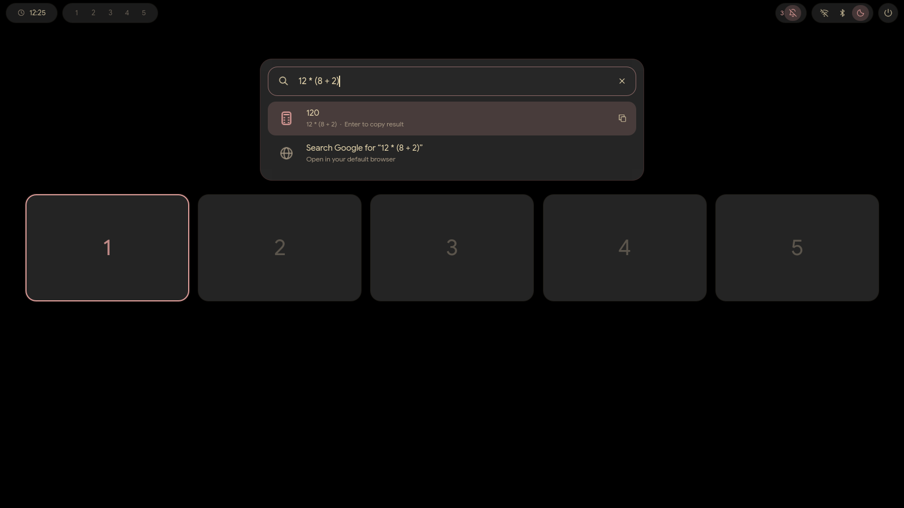

# MiraOS Dots

MiraOS Dots is the Lua Hyprland configuration and Quickshell desktop used on MiraOS. The bar includes media controls, system tray, connectivity, notifications and session actions. Quickshell also provides the app launcher, workspace overview, lock screen, volume overlay, clipboard history, emoji picker and wallpaper picker.

The desktop uses #282828-based neutrals and wallpaper-derived Matugen accents. Google Sans is used for interface text when installed. Kitty uses JetBrainsMono Nerd Font Mono.



[Emoji picker](docs/screenshots/emoji.png) · [Volume overlay](docs/screenshots/volume.png)

## Requirements

Use an up-to-date Arch Linux system with a regular user account and access to `sudo`. The installer checks for Hyprland 0.57 or newer and Quickshell 0.3.2 or newer. The packages come from the official repositories. [Package list](scripts/packages.conf) · [Quickshell on Arch](https://archlinux.org/packages/extra/x86_64/quickshell/)

The configuration uses `~/.config`, `~/.local/bin` and `~/.local/share`. Monitor layout defaults to preferred mode and automatic positioning and scale. Add local monitor overrides to `~/.config/hypr/modules/local-overrides.lua`.

Network controls use NetworkManager. On a machine set up to use NetworkManager, enable it with `sudo systemctl enable --now NetworkManager.service`. For Bluetooth, enable `bluetooth.service` with the same command. The volume overlay uses PipeWire and WirePlumber. The lock screen uses Arch's `system-auth` PAM service.

## Installation

From the repository directory, run:

```sh
./install.sh --dry-run
./install.sh
```

The installer lists missing packages and existing files that would be replaced. It asks before installing packages with a full Arch upgrade or applying desktop changes. Original files, previous desktop preferences and the installation manifest are kept under `~/.local/state/miraos-dots/`. Start a new Hyprland session when convenient. On a TTY, run `start-hyprland`.

If Dunst, Mako, SwayNC or another notification daemon is configured to start with the session, disable its startup before using the Quickshell notification center. Quickshell registers the standard notification service.

Fish loads the prompt and user helper path from `conf.d/miraos.fish`. Bash users can add these lines to their own `~/.bashrc` once:

```bash
export PATH="$HOME/.local/bin:$PATH"
eval "$(starship init bash)"
```

Install a copy of Google Sans from a source you are allowed to use in `~/.local/share/fonts/`, then run `fc-cache -f`. The installer supplies fallback fonts and sets the GTK font and dark color preference through GSettings.

## Optional components

Pass any of these flags to `install.sh`. Each system-wide change has its own confirmation.

| Flag | Adds |
| --- | --- |
| `--sddm` | The custom SDDM theme and wallpaper/palette integration |
| `--boot` | The MiraOS logo for compatible unsigned Arch UKIs. See [boot branding](docs/boot.md). |
| `--qt5` | The Qt 5 live palette bridge built from the included source |
| `--wallpapers` | The official Arch wallpaper package |
| `--integrations` | Firefox, Nautilus and Blueman for the desktop shortcuts and menus |

The SDDM theme takes effect the next time the configured SDDM greeter starts. The helper reports any higher-priority SDDM configuration that overrides the selection. The boot option applies only to a supported existing Arch splash configuration.

## Shortcuts

| Shortcut | Action |
| --- | --- |
| Tap left Super | Launcher and workspace overview |
| Super+V | Clipboard picker |
| Super+. | Emoji picker |
| Ctrl+Shift+Super+Space | Wallpaper picker |
| Super+Enter | Kitty |
| Super+Q / Super+E | Firefox / Nautilus |
| Super+W | Close focused window |
| Super+1–0 | Switch workspace |
| Super+Shift+1–0 | Move window to workspace |
| Super+Shift+S | Region screenshot |

Right-click a tray app to invoke its Quit or Exit action, when offered. Shift+right-click opens its menu. The bar bell opens notification history, the moon toggles Do Not Disturb, and the power menu offers Sleep, Lock, Log Out, Shut Down and Reboot.

## Wallpaper and color

Open the wallpaper picker to add a local image and set it. The picker uses awww and the Waypaper configuration format. Matugen updates the shell, terminal, window borders, GTK/Qt colors and the optional SDDM theme. If the desktop starts before a wallpaper is selected, it uses the included palette. The user's wallpaper library is kept outside the repository.

GTK and Qt live recoloring depends on each application and toolkit. Libadwaita receives the nearest supported named accent. Google Sans and the terminal font are independent of palette changes.

## Updates and removal

Run `./install.sh --dry-run` from the updated checkout, then run `./install.sh` again with the options you want to install. The installer skips unchanged files and keeps existing wallpaper choices and generated palettes.

```sh
./uninstall.sh --dry-run --restore
./uninstall.sh --restore
```

The uninstaller checks the manifest and preserves files that have changed since installation. `--restore` restores the original file where there is a backup and the installed file is unmodified. Runtime state such as wallpaper choices and clipboard history stays in your home directory. To remove the optional system-wide assets, pass `--sddm` or `--boot` and confirm. System packages and backup records are retained.

## Troubleshooting

- Check the Hyprland config with `hyprland --verify-config -c ~/.config/hypr/hyprland.lua`.
- Check shell logs with `~/.local/bin/quickshell-bar logs -t 30`.
- Check the wallpaper watcher with `systemctl --user status miraos-wallpaper-theme.path`. View theme generation errors with `journalctl --user -u miraos-wallpaper-theme.service`.
- Check that `fc-match 'Google Sans'` resolves the installed face.
- For app launcher web searches, configure your preferred default browser with the normal desktop MIME settings.

See [validation results](docs/validation.md) and [credits and licenses](docs/credits.md).
